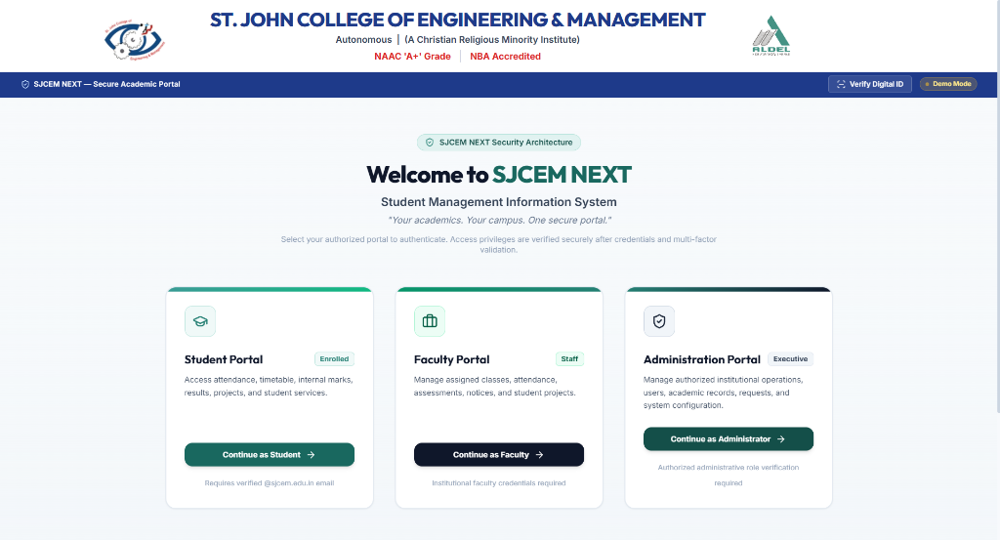
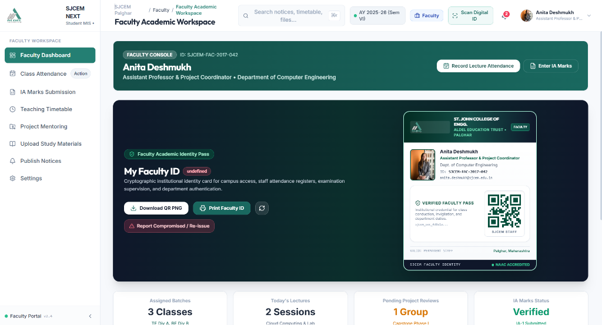
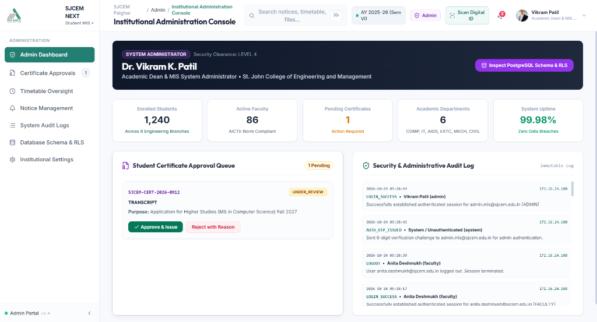

# SJCEM NEXT — Student Management Information System

> **St. John College of Engineering and Management (SJCEM), Palghar, Maharashtra, India**
> Under the management of **ALDEL Education Trust**
> Autonomous | NAAC ''A+'' Grade | NBA Accredited | Affiliated to University of Mumbai & MSBTE

---

## Table of Contents

1. [Overview](#overview)
2. [Project Highlights](#project-highlights)
3. [Project Screenshots](#project-screenshots)
4. [Features](#features)
5. [Technology Stack](#technology-stack)
6. [System Architecture](#system-architecture)
7. [Project Structure](#project-structure)
8. [Prerequisites](#prerequisites)
9. [Installation & Local Setup](#installation--local-setup)
10. [Running the Application](#running-the-application)
11. [Demo Accounts](#demo-accounts)
12. [Database Setup (Supabase)](#database-setup-supabase)
13. [Security & Privacy](#security--privacy)
14. [Deployment](#deployment)
15. [Troubleshooting](#troubleshooting)
16. [Roadmap](#roadmap)
17. [Contributing](#contributing)
18. [License](#license)
19. [Acknowledgements & Disclaimer](#acknowledgements--disclaimer)

---

## Overview

**SJCEM NEXT** is a modern, browser-based Student Management Information System (MIS) designed for St. John College of Engineering and Management, Palghar. It replaces fragmented manual or legacy institutional workflows with a unified, role-aware academic portal accessible from any device including mobile phones.

The application serves three user roles:

- **Students** — view attendance, timetable, internal marks, semester results, notices, study resources, certificate requests, and academic projects.
- **Faculty** — manage assigned subjects, record attendance sessions, view student profiles, and oversee project submissions.
- **Administrators** — access system-wide audit logs, manage QR identity tokens, publish notices, and review certificate requests.

The current version (`v2.4.0`) is a **frontend-only, client-side demonstration** backed by a structured mock dataset. A Supabase schema with Row-Level Security (RLS) policies has been authored and is ready for backend integration. **No live database connection is active in the current deployment.**

---

## Project Highlights

- Multi-role authentication with a two-step email OTP verification flow (simulated in demo mode)
- Role-based portal separation: student, faculty, and administrator portals enforce strict access control at the UI layer
- QR-based digital identity cards for students and faculty, with a built-in camera scanner to verify identity
- Academic analytics dashboard with Chart.js visualizations for attendance trends and performance metrics
- Certificate request management with automated reference ID generation and status tracking
- Academic project workspace with milestone tracking and submission workflow
- AI campus assistant (rule-based, no external API) that answers queries about attendance, schedule, notices, and certificate procedures using live session data
- Mobile-first responsive design with a native-style bottom navigation bar, iOS safe-area insets, and touch-optimized inputs
- Institutional branding matching SJCEM and ALDEL letterhead conventions
- All data persisted client-side via `localStorage`; no user data is transmitted to any server in the current build

---

## Project Screenshots

> [!NOTE]
> Screenshot assets are located in [`public/screenshots/`](public/screenshots/). When captured and placed into this directory, GitHub renders them directly in the gallery below.

| View / Portal | Screenshot Preview | Description & Key Highlights |
| :--- | :---: | :--- |
| **Authentication & Role Selection** | <br><sub>*File: `public/screenshots/login.png`*</sub> | **Multi-Role Authentication Gateway**<br>Institutional login page with SJCEM and ALDEL Trust branding, dedicated role selector tabs (Student, Faculty, Administrator), and 2-step simulated OTP verification. |
| **Student Dashboard** | <br><sub>*File: `public/screenshots/student-dashboard.png`*</sub> | **Academic Overview & Attendance Tracker**<br>Personalised student home screen highlighting aggregate attendance metrics, today's lecture schedule, recent announcements, and quick access to study resources. |
| **Faculty Dashboard** | <br><sub>*File: `public/screenshots/faculty-dashboard.png`*</sub> | **Instructional Hub & Class Management**<br>Teaching interface showcasing allocated division courses, rapid attendance recording, student progress analytics, and project submission evaluations. |
| **Administrator Dashboard** | <br><sub>*File: `public/screenshots/admin-dashboard.png`*</sub> | **Institutional Administration & Governance**<br>System-wide administrative console showing real-time security audit events, QR identity token verification status, certificate approvals, and notice broadcasts. |

<details>
<summary>📸 <strong>Screenshot Capture Guide for Maintainers</strong></summary>

To capture and update these screenshots for the repository:
1. Launch the application locally (`npm run dev` or `python -m http.server 5173`).
2. Recommended browser resolution: **1280×800** or **1920×1080** (16:10 or 16:9 aspect ratio).
3. Save each screenshot directly to `public/screenshots/` with the exact filenames:
   - `public/screenshots/login.png` — Landing page at `http://localhost:5173/`
   - `public/screenshots/student-dashboard.png` — Student portal (`rahul.sharma@sjcem.edu.in`)
   - `public/screenshots/faculty-dashboard.png` — Faculty portal (`anita.deshmukh@sjcem.edu.in`)
   - `public/screenshots/admin-dashboard.png` — Administrator console (`admin@sjcem.edu.in`)
4. Ensure no real passwords, live API tokens, or confidential student PII are exposed in captured visuals.
</details>

---

## Features

### Authentication & Session Management

| Feature | Status |
|---|---|
| Role-selection landing page (Student / Faculty / Administrator) | Implemented |
| Email + password credential validation | Implemented (mock, client-side) |
| Strict role-portal separation (cross-role login rejected) | Implemented |
| Two-step 6-digit OTP verification (5-minute expiry, 3-attempt limit) | Implemented (OTP shown on-screen in demo) |
| Session token generation and localStorage persistence | Implemented |
| Logout and session invalidation | Implemented |
| Audit log for authentication events | Implemented (client-side) |
| Real email delivery of OTP | Not implemented — planned via Supabase Auth |
| JWT-based server authentication | Not implemented — planned via Supabase Auth |

### Student Portal

| Feature | Status |
|---|---|
| Personalised dashboard with attendance summary and today's schedule | Implemented |
| Subject-wise attendance records with percentage calculation | Implemented |
| Attendance filtering by subject and status | Implemented |
| Weekly timetable grid view | Implemented |
| Daily agenda view with subject, time, faculty, and room details | Implemented |
| Internal marks view (unit tests, assignments, practicals) | Implemented |
| Semester examination results with SGPA and CGPA | Implemented |
| Notices and circulars with category filters and search | Implemented |
| Study resources list with subject filtering | Implemented |
| Certificate request submission (Bonafide, Leaving, Transcript) | Implemented |
| Certificate request status tracking and reference IDs | Implemented |
| Academic project workspace with milestone view | Implemented |
| QR digital identity card generation and display | Implemented |
| Profile page with personal, academic, and guardian details | Implemented |
| Notification centre with unread badge counts | Implemented |
| Global search across notices, resources, and routes | Implemented |
| Settings page (theme, notification preferences) | Implemented (UI only) |
| Help & support ticket submission | Implemented (client-side) |

### Faculty Portal

| Feature | Status |
|---|---|
| Faculty dashboard with assigned subjects and class schedule | Implemented |
| Faculty QR digital identity card | Implemented |
| Student attendance recording interface | Implemented (updates mock store) |
| Faculty profile view | Implemented |
| Student list and profile lookup | Implemented |
| Project submission review | Implemented |
| Marks entry interface | Implemented |

### Administrator Portal

| Feature | Status |
|---|---|
| System-wide audit log viewer | Implemented |
| QR token registry management (view, revoke) | Implemented |
| Certificate request approval workflow | Implemented |
| Notice publication | Implemented |
| Admin dashboard with system statistics | Implemented |

### QR-Based Digital Identity

| Feature | Status |
|---|---|
| Per-user opaque token generation embedded in QR code | Implemented |
| QR code display on identity card (via QRious library) | Implemented |
| In-app camera scanner for identity verification (html5-qrcode) | Implemented |
| Scan result display with validity status (VALID / REVOKED / EXPIRED / UNKNOWN) | Implemented |
| Scan count tracking per token | Implemented (mock) |
| Token revocation by administrator | Implemented (mock) |

### Academic Analytics

| Feature | Status |
|---|---|
| Attendance trend charts (Chart.js bar and doughnut) | Implemented |
| Subject-wise performance radar chart | Implemented |
| SGPA progression chart across semesters | Implemented |
| Low-attendance subject alerts | Implemented |

### AI Campus Assistant

| Feature | Status |
|---|---|
| Natural language query interface | Implemented |
| Attendance-aware responses (reads live session data) | Implemented |
| Timetable and next-class queries | Implemented |
| Notice and circular summaries | Implemented |
| Certificate procedure guidance | Implemented |
| Project milestone guidance | Implemented |
| SJCEM institutional information (admission, fees, NAAC) | Implemented |
| Integration with external LLM API | Not implemented — responses are rule-based |

---

## Technology Stack

| Layer | Technology | Notes |
|---|---|---|
| **Frontend Language** | Vanilla JavaScript (ES Modules) | No build step required |
| **Markup** | HTML5 | Single index.html entry point |
| **Styling** | Tailwind CSS v3 (local vendor script) | Configured inline in index.html |
| **Typography** | Inter, Outfit (Google Fonts) | Loaded via CDN |
| **Icons** | Lucide Icons (bundled) | Rendered via lucide.createIcons() |
| **Charts** | Chart.js v4 (bundled) | Used in Analytics page |
| **QR Generation** | QRious v2 (bundled) | Generates identity card QR codes |
| **QR Scanning** | html5-qrcode (bundled) | Camera-based QR scanner |
| **State Management** | Custom MisStore class | localStorage persistence |
| **Mock Data** | src/data/mockDatabase.js | Static JavaScript module |
| **Dev Server** | Python http.server | No Node.js build toolchain in use |
| **Database Schema** | PostgreSQL (Supabase) | Migrations written, not yet connected |
| **Auth (Planned)** | Supabase Auth | Schema authored, not yet integrated |
| **Deployment** | Netlify (static hosting) | Deployed via Netlify CLI |

> **Note:** The repository also contains TypeScript source files (App.tsx, store.ts, aiAssistant.ts, main.tsx) and a vite.config.ts from an earlier scaffolding phase. These files are **not used by the running application**. The active application is driven exclusively by the JavaScript ES module entry point at src/app.js.

---

## System Architecture

```
Browser
  |
  +--> index.html (Entry Point)
        |
        +--> Vendor Libraries (Tailwind, Lucide, Chart.js, QRious, html5-qrcode)
        |
        +--> src/app.js (Router & Controller)
              |
              +--> MisStore (State & localStorage)
              |       |
              |       +--> mockDatabase.js (Fixture Data)
              |       +--> localStorage (Session Persistence)
              |
              +--> Pages (17 JS modules)
              +--> Components (Layout, Modals)
```

**Current data flow:** The browser loads `index.html`, which bootstraps Tailwind and vendor libraries, then executes `src/app.js` as an ES module. The app router controls which page renders inside `#app`. All data reads and writes pass through `MisStore`, which loads initial values from `mockDatabase.js` and persists changes in `localStorage`. No network requests are made to any backend.

**Backend integration path:** The Supabase migrations define the full database schema and RLS policies. When integration is ready, `MisStore` will be refactored to call the Supabase JavaScript client in place of the current mock data layer.

---

## Project Structure

```
sjcem-student-mis/
├── index.html                          # Application entry point
├── package.json                        # Project metadata and dev scripts
├── .gitignore
├── README.md
|
├── public/
│   ├── assets/
│   │   ├── aldel-logo.png              # ALDEL Education Trust official logo
│   │   ├── sjcem-logo.png              # SJCEM college crest (primary)
│   │   └── sjcem-logo-official.png     # SJCEM college crest (alternate)
│   ├── vendor/
│   │   ├── tailwind.js                 # Tailwind CSS (offline bundle)
│   │   ├── lucide.min.js               # Lucide icon library
│   │   ├── chart.umd.js                # Chart.js v4
│   │   ├── qrious.min.js               # QR code generation
│   │   └── html5-qrcode.min.js         # Camera QR code scanner
│   ├── favicon.svg
│   └── icons.svg
|
├── src/
│   ├── app.js                          # Main router and application controller
│   ├── data/
│   │   └── mockDatabase.js             # All fixture data
│   ├── services/
│   │   ├── store.js                    # State management and localStorage persistence
│   │   └── aiAssistant.js              # Rule-based AI campus assistant
│   ├── components/
│   │   ├── layout/
│   │   │   ├── Navbar.js               # Top navigation bar
│   │   │   ├── Sidebar.js              # Collapsible desktop sidebar
│   │   │   └── BottomNav.js            # Mobile bottom navigation bar
│   │   └── modals/
│   │       ├── ActionModals.js         # QR card, scanner, certificate, project modals
│   │       ├── GlobalSearchModal.js    # Global search overlay
│   │       ├── NotificationCenter.js   # Notification panel
│   │       └── RoleSwitcherModal.js    # Role context switcher
│   ├── pages/
│   │   ├── AuthPages.js                # Login landing, credential form, OTP view
│   │   ├── OverviewPage.js             # Student dashboard
│   │   ├── AttendancePage.js           # Attendance records and filters
│   │   ├── TimetablePage.js            # Weekly grid and daily agenda
│   │   ├── MarksResultsPage.js         # Internal marks and semester results
│   │   ├── AnalyticsPage.js            # Chart.js academic analytics
│   │   ├── NoticesPage.js              # Notices and circulars
│   │   ├── ResourcesPage.js            # Study resources
│   │   ├── ProjectsPage.js             # Academic project workspace
│   │   ├── CertificatesPage.js         # Certificate request management
│   │   ├── RequestsPage.js             # Request history and tracking
│   │   ├── ProfilePage.js              # User profile and digital ID card
│   │   ├── AiAssistantPage.js          # AI campus assistant chat interface
│   │   ├── FacultyWorkspace.js         # Faculty-specific portal
│   │   ├── AdminWorkspace.js           # Administrator-specific portal
│   │   ├── HelpSupportPage.js          # Help articles and support tickets
│   │   └── SettingsPage.js             # Application settings
│   └── styles/
│       └── main.css                    # Custom CSS tokens, animations, mobile ergonomics
|
└── supabase/
    └── migrations/
        ├── 20261023_sjcem_schema.sql               # Core schema + RLS policies
        └── 20261023_qr_identity_and_auth_schema.sql # QR tokens + OTP + scan audit logs
```

---

## Prerequisites

| Requirement | Version | Purpose |
|---|---|---|
| **Python** | 3.8 or later | Local development server (http.server) |
| **Web Browser** | Any modern browser | Chrome, Firefox, Edge, Safari (mobile included) |
| **Git** | Any recent version | Cloning the repository |

No Node.js, npm, or build tools are required to run the application. npm is only needed if you wish to install the Netlify CLI for deployment.

---

## Installation & Local Setup

```powershell
# 1. Clone the repository
git clone https://github.com/bipinmaurya5567-bit/sjcem-student-mis.git

# 2. Navigate into the project directory
cd sjcem-student-mis

# 3. No dependencies to install — the application runs entirely from static files
```

---

## Running the Application

Start the Python development server from the project root:

```powershell
python -m http.server 5173
```

Then open your browser and navigate to:

```
http://localhost:5173
```

The application loads immediately. No build step, no compilation, no environment variables are required for local use.

> **Why Python's http.server?** The application uses native ES modules (type="module" in index.html). Browsers require files to be served over HTTP rather than opened directly from the filesystem (file:// protocol) for ES modules to work correctly.

**Alternative — use npm scripts (these also invoke Python):**

```powershell
npm run dev
# or
npm start
```

---

## Demo Accounts

The application ships with three pre-configured demonstration accounts. These are fictional identities created for evaluation purposes only.

> **Security note:** These credentials are hardcoded fixture data inside `src/data/mockDatabase.js`. They do not correspond to any real person or real institutional account.

| Role | Email | Password | Portal |
|---|---|---|---|
| Student | rahul.sharma@sjcem.edu.in | Student@Sjcem2026 | Student Portal |
| Faculty | anita.deshmukh@sjcem.edu.in | Faculty@Sjcem2026 | Faculty Portal |
| Administrator | admin.mis@sjcem.edu.in | Admin@Sjcem2026 | Admin Portal |

Universal demo master password (accepted by any account):

```
DemoSecurePass2026!
```

**Login flow:**

1. Open the application and select your role (Student, Faculty, or Administrator).
2. Enter the corresponding email and password.
3. A 6-digit OTP is generated. In demo mode, the OTP code is **displayed directly on the verification screen** — copy and enter it to complete login.
4. The session is established and persisted in localStorage.

---

## Database Setup (Supabase)

> **Current state:** The Supabase schema and RLS policies have been authored but the frontend application does not yet connect to any Supabase project. The instructions below describe how to apply the schema when backend integration is ready.

### Schema overview

Two SQL migration files are provided under `supabase/migrations/`:

**`20261023_sjcem_schema.sql`** defines the full academic data model:
- Institutional structure: `departments`, `programs`, `academic_years`, `semesters`, `divisions`
- Identity: `profiles`, `user_roles`, `student_enrollments`
- Academic: `subjects`, `faculty_assignments`, `timetable_slots`
- Records: `attendance_sessions`, `attendance_records`, `assessment_marks`, `semester_results`
- Communication: `notices`, `notice_reads`, `study_resources`, `notifications`
- Workflow: `projects`, `project_members`, `project_submissions`, `project_reviews`, `certificate_requests`, `request_status_history`
- Operations: `support_tickets`, `audit_logs`
- Row-Level Security policies on all tables and a helper function `auth_user_has_role()`

**`20261023_qr_identity_and_auth_schema.sql`** defines the QR and OTP subsystem:
- `qr_identity_tokens` — hashed tokens with expiry and revocation
- `email_otp_challenges` — server-side OTP with attempt limiting
- `scan_audit_logs` — immutable scan event log
- Row-Level Security policies for all three tables

### Applying migrations

Apply each migration file through the Supabase SQL Editor in your project dashboard. Paste the file contents and execute. Do not run `supabase db push` unless the Supabase CLI is configured and linked to your project.

---

## Security & Privacy

### Implemented safeguards

- **Role-portal separation:** A student account cannot authenticate through the faculty or administrator portal. Cross-role attempts are rejected and written to the audit log.
- **OTP attempt limiting:** The OTP verification step allows a maximum of 3 failed attempts before the challenge is invalidated.
- **OTP expiry:** Each challenge expires after 5 minutes.
- **Session token:** A random token is generated on successful login and stored in localStorage. Absence of this token forces re-authentication on page reload.
- **Audit logging:** Authentication events are recorded in a client-side audit log accessible to the Administrator role.
- **Database RLS policies:** The Supabase migrations define Row-Level Security policies restricting data access by authenticated user identity and role. These are ready for production use once the backend is connected.

### Known limitations in the current version

| Limitation | Detail |
|---|---|
| Client-side authentication only | Credentials are stored as plaintext strings in mockDatabase.js. Any person who inspects source code can read all demo passwords. |
| OTP displayed on-screen | In demo mode, the generated OTP is rendered in the UI. In production, the OTP must be sent exclusively via email and never exposed client-side. |
| No real email delivery | The email OTP flow is fully simulated. No email is sent. |
| localStorage is inspectable | All session data stored in localStorage can be read and modified using browser developer tools. |
| No input sanitisation | Template literal HTML construction does not sanitise all user-controlled values. Acceptable for a fixed-data demo; must be addressed before processing real user input. |
| Passwords are not hashed | Demo passwords in mockDatabase.js are stored as plaintext. The Supabase schema uses Supabase Auth (bcrypt internally) for production, but this is not yet connected. |

---

## Deployment

The application is a pure static site and can be deployed to any static hosting service without a build step.

### Netlify CLI

```powershell
# Install Netlify CLI (requires Node.js)
npm install -g netlify-cli

# Deploy anonymously — no account required, provides a temporary URL
netlify deploy --allow-anonymous --dir "." --no-build

# Deploy to production with a free Netlify account
netlify deploy --prod --dir "."
```

After an anonymous deploy, Netlify provides a temporary URL. Claim the site by signing in to a free Netlify account using the claim link in the deploy output to make the URL permanent.

### Netlify Drop (no CLI required)

1. Go to https://app.netlify.com/drop
2. Drag and drop the entire project folder onto the page.
3. Netlify publishes the site and provides a public URL immediately.

### Other static hosts

- **GitHub Pages** — Enable in repository settings. Set source to the root directory of the main branch.
- **Vercel** — Link the GitHub repository. Set framework to "Other" and output directory to the project root.
- **Surge.sh** — `npm install -g surge` then `surge . your-domain.surge.sh`

No build command or environment variables are required for any of these.

---

## Troubleshooting

**Page shows a CORS or module loading error when opened via file://**

The application must be served over HTTP. Run `python -m http.server 5173` and open `http://localhost:5173`.

---

**QR camera scanner does not activate**

The html5-qrcode library requires a secure context. Ensure you are using `http://localhost` or an HTTPS deployment, and that the browser has been granted camera permission for the site.

---

**Application shows a blank screen after login**

Open browser developer tools (F12) and check the Console tab for JavaScript errors. This is typically caused by serving the application from a path that does not correctly resolve the `public/vendor/` or `src/` relative imports. Always serve from the project root directory.

---

**localStorage data appears stale or corrupted after code changes**

Open developer tools, go to Application -> Local Storage -> http://localhost:5173, and delete all keys prefixed with `sjcem_`. The application reinitialises from the mock database on next load.

---

**Python not found on Windows**

```powershell
python --version
# If not found, try the py launcher:
py --version
py -m http.server 5173
```

---

## Roadmap

The following capabilities are planned and are not present in the current version:

- Connect frontend to live Supabase Auth and PostgreSQL using the authored schema
- Real email OTP delivery via Supabase Auth or a transactional email provider
- Password reset flow with email verification
- Multi-student and multi-faculty accounts with individual enrolment records
- Faculty bulk attendance entry with CSV export
- Automated semester result import from university examination API
- Push notifications for notices and certificate status changes
- PDF generation for bonafide and leaving certificates
- Progressive Web App (PWA) support for offline access and home screen installation
- Supabase Realtime subscriptions for live notice and attendance updates
- Comprehensive input validation and XSS-safe HTML rendering
- Admin panel for user provisioning and department management

---

## Contributing

Contributions are welcome from students, faculty, and developers interested in college MIS systems.

```powershell
# 1. Fork the repository on GitHub

# 2. Clone your fork
git clone https://github.com/YOUR_USERNAME/sjcem-student-mis.git
cd sjcem-student-mis

# 3. Create a feature branch
git checkout -b feature/your-feature-name

# 4. Make your changes and test locally
python -m http.server 5173

# 5. Commit with a clear message
git add .
git commit -m "feat: describe your change concisely"

# 6. Push and open a Pull Request
git push origin feature/your-feature-name
```

Before submitting a pull request, test the application for all three roles (student, faculty, admin) and ensure the QR scanner and analytics charts load without console errors. Do not commit real personal data, credentials, or private keys.

---

## License

The licensing terms for this repository have not yet been specified. Until a license is added, standard copyright law applies — no permission is granted to use, copy, modify, or distribute the code without explicit written permission from the repository owner.

---

## Acknowledgements & Disclaimer

- **Institution:** St. John College of Engineering and Management (SJCEM), Vevoor, Palghar (W) 401404, Maharashtra, India
- **Trust:** ALDEL Education Trust
- **Accreditations referenced:** NAAC 'A+' Grade, NBA Accreditation, AICTE approval, DTE recognition, affiliation to University of Mumbai and MSBTE — as stated in SJCEM's official institutional records

**Disclaimer:** This project is an independent academic software demonstration. It is not an official product of St. John College of Engineering and Management or ALDEL Education Trust, and is not endorsed by either institution. All student, faculty, and administrative data used in this application are entirely fictional and created solely for demonstration purposes. No real personal information of any student, faculty member, or staff has been used or stored.
