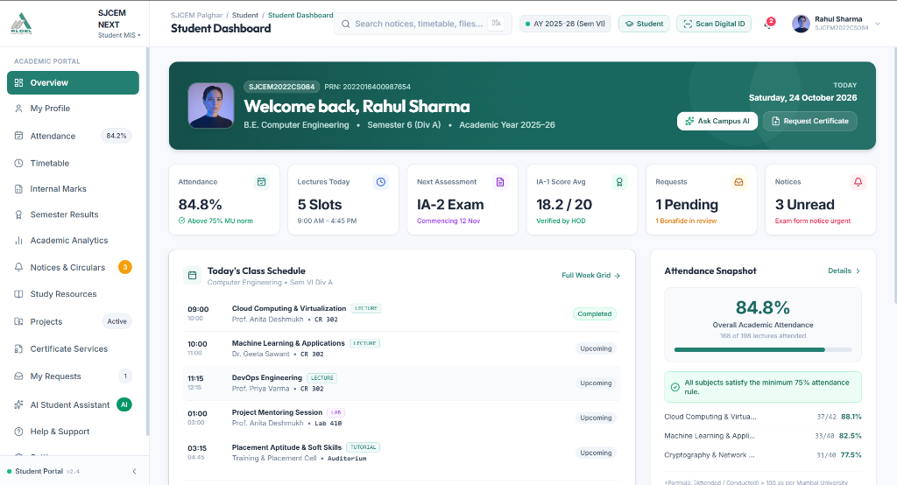
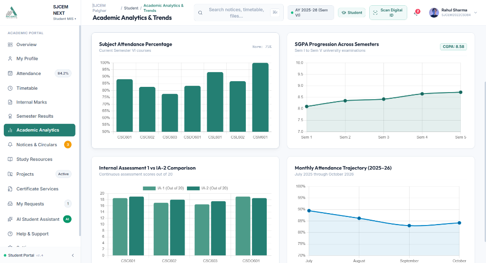
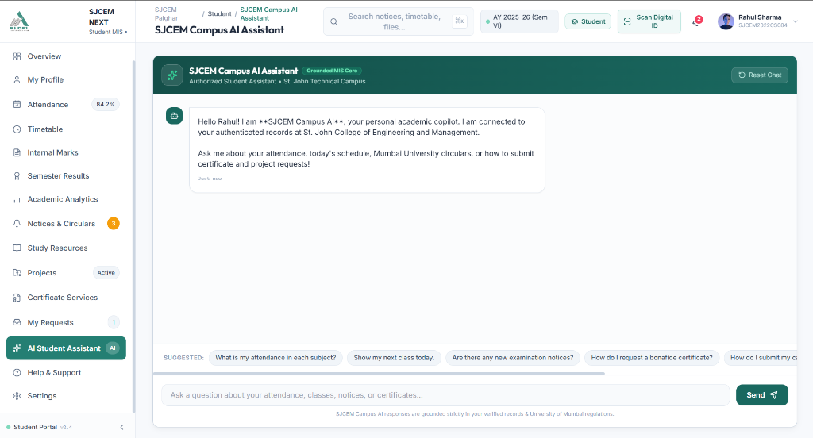
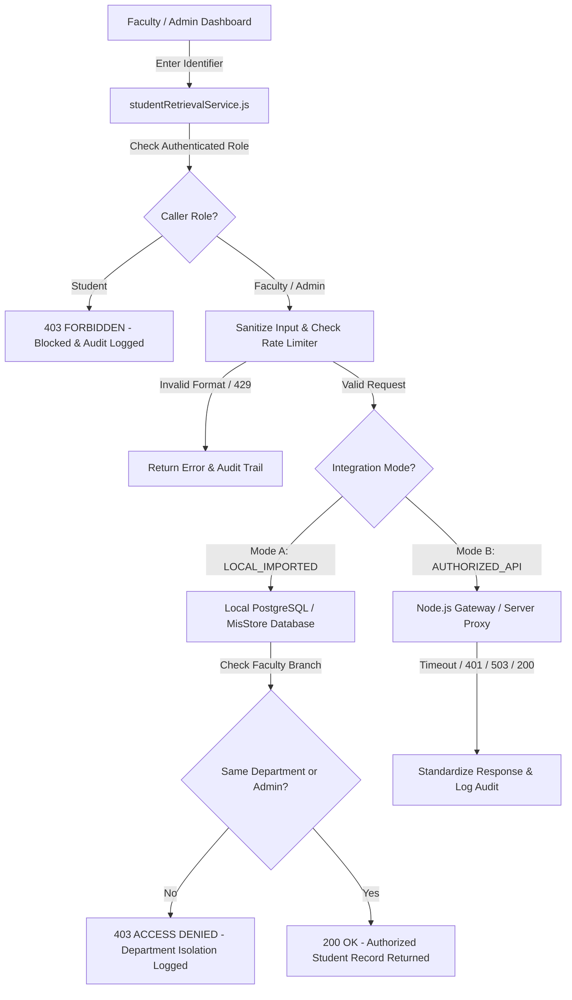

# SJCEM NEXT — Student Management Information System (MIS)

<p align="center">
  
</p>

<p align="center">
  <strong>Next-Generation Academic Management &amp; Institutional Governance Platform</strong><br>
  <sub>Designed for St. John College of Engineering and Management (SJCEM), Palghar</sub>
</p>

<p align="center">
  <a href="https://github.com/bipinmaurya5567-bit/sjcem-student-mis"></a>
  <a href="#technology-stack"></a>
  <a href="#technology-stack"></a>
  <a href="#database-and-supabase-configuration"></a>
  <a href="#testing-and-build-commands"></a>
  <a href="#academic-project-information-and-institution"></a>
</p>

> **Institution:** St. John College of Engineering and Management (SJCEM), Palghar, Maharashtra, India  
> **Governing Trust:** ALDEL Education Trust  
> **Academic Standing:** Autonomous | NAAC 'A+' Grade | NBA Accredited | Approved by AICTE, Recognized by DTE Maharashtra, Affiliated to University of Mumbai & MSBTE  
> **Repository:** [https://github.com/bipinmaurya5567-bit/sjcem-student-mis](https://github.com/bipinmaurya5567-bit/sjcem-student-mis)

---

> [!IMPORTANT]
> **Project Implementation & Evaluation Status:**  
> SJCEM NEXT (`v2.4.0`) is a feature-complete academic information system featuring client-side state persistence, a secure Node.js API Gateway, comprehensive TypeScript type definitions, and authored Supabase PostgreSQL relational schemas with Row-Level Security (RLS) policies.
>
> All demonstrations and evaluation sessions use synthetic institutional test datasets. In strict compliance with Indian IT Act provisions, FERPA standards, and college computer security policies, **no live production connection to external college servers or private student databases is claimed or active** without authorized institutional access keys.

---

## Project Screenshots

High-resolution previews captured directly from the active application running in local demonstration mode. All views use institutional synthetic test data; no real student PII, credentials, or confidential server secrets are exposed.

| Portal & View | Interface Preview | Architectural Role & Capabilities |
| :--- | :---: | :--- |
| **Authentication & Role Selection** | <a href="docs/screenshots/login.png"></a> | **Unified Role Gateway**<br>Institutional authentication landing screen featuring SJCEM & ALDEL Trust heraldry, strict three-way portal separation (**Student**, **Faculty**, **Administrator**), 1-click evaluation shortcuts, and simulated two-step OTP challenge modals. |
| **Student Academic Dashboard** | <a href="docs/screenshots/student-dashboard.png"></a> | **Personalised Academic Cockpit**<br>Student home screen highlighting real-time aggregate attendance (84.8% vs 75% Mumbai University norm), today's 5-slot lecture schedule, IA score averages, pending certificate requests, unread circular badges, and quick service links. |
| **Academic Analytics & Trends** | <a href="docs/screenshots/student-analytics.png"></a> | **Visual Performance Intelligence**<br>Interactive Chart.js visualizations tracking subject attendance rates, multi-semester SGPA progression curves (CGPA 8.58 across Semesters 1–5), internal assessment (IA-1 vs IA-2) comparisons, and monthly attendance trajectories. |
| **Faculty Academic Workspace** | <a href="docs/screenshots/faculty-dashboard.png"></a> | **Instructional Management Console**<br>Teaching workspace featuring the cryptographic Faculty Academic Identity Pass with QR verification, assigned semester batches, one-click lecture attendance registers, IA marks submission, and capstone project review queues. |
| **Administration Console** | <a href="docs/screenshots/admin-dashboard.png"></a> | **Institutional Governance & Compliance**<br>Administrative cockpit with campus-wide roster analytics, teaching faculty counts, pending certificate approval queues, real-time security audit trails, and interactive database schema inspection across 16 tables. |
| **Campus AI Assistant** | <a href="docs/screenshots/ai-assistant.png"></a> | **Academic Conversational Copilot**<br>Context-aware conversational assistant grounded in the authenticated student's active records, answering queries regarding low-attendance warnings, daily timetable slots, circulars, and bonafide certificate workflows. |

<details>
<summary>📸 <strong>Screenshot Asset Inventory & Repository File Links</strong></summary>

All active screenshot assets are version-controlled in the repository under [`docs/screenshots/`](docs/screenshots/):
- [`docs/screenshots/login.png`](docs/screenshots/login.png) — Role-selection authentication portal (`/login`)
- [`docs/screenshots/student-dashboard.png`](docs/screenshots/student-dashboard.png) — Student academic overview (`rahul.sharma@sjcem.edu.in`)
- [`docs/screenshots/student-analytics.png`](docs/screenshots/student-analytics.png) — Academic analytics and Chart.js trend visualizations
- [`docs/screenshots/faculty-dashboard.png`](docs/screenshots/faculty-dashboard.png) — Faculty workspace with cryptographic QR pass (`anita.deshmukh@sjcem.edu.in`)
- [`docs/screenshots/admin-dashboard.png`](docs/screenshots/admin-dashboard.png) — Institutional administration console (`admin.mis@sjcem.edu.in`)
- [`docs/screenshots/ai-assistant.png`](docs/screenshots/ai-assistant.png) — SJCEM Campus AI Assistant conversational copilot
</details>

---

## Table of Contents

1. [Project Overview & Problem Statement](#project-overview--problem-statement)
2. [Objectives & Key Features](#objectives--key-features)
3. [Student Portal](#student-portal)
4. [Faculty Portal](#faculty-portal)
5. [Admin Portal](#admin-portal)
6. [Digital ID Cards & QR Verification](#digital-id-cards--qr-verification)
7. [Student Information Retrieval & Integration Architecture](#student-information-retrieval--integration-architecture)
8. [Authentication & Authorization Architecture](#authentication--authorization-architecture)
9. [Database & Supabase Configuration](#database--supabase-configuration)
10. [Technology Stack](#technology-stack)
11. [Project Structure](#project-structure)
12. [Installation & Local Setup](#installation--local-setup)
13. [Environment Variables](#environment-variables)
14. [Demo Accounts & Evaluation Flow](#demo-accounts--evaluation-flow)
15. [Testing & Build Commands](#testing--build-commands)
16. [Known Limitations & Future Scope](#known-limitations--future-scope)
17. [Contributors](#contributors)
18. [Academic Project Information & Disclaimer](#academic-project-information--disclaimer)

---

## Project Overview & Problem Statement

Colleges and higher education engineering institutes frequently manage daily academic operations across fragmented channels: physical attendance registers, scattered spreadsheet trackers, delayed physical notice boards, and manual bonafide certificate queues. Students face uncertainty tracking their statutory 75% attendance threshold, while faculty spend valuable lecture hours manually computing attendance averages and collating Internal Assessment (IA) marks.

**SJCEM NEXT** solves these challenges by providing a unified, role-isolated academic ecosystem specifically tailored to the workflow of **St. John College of Engineering and Management (SJCEM)** under the **ALDEL Education Trust**:

```
                       ┌─────────────────────────────────────────┐
                       │     SJCEM NEXT Academic Portal          │
                       │     Role-Aware Client & UI Gateway      │
                       └────────────────────┬────────────────────┘
                                            │
               ┌────────────────────────────┼────────────────────────────┐
               ▼                            ▼                            ▼
  ┌─────────────────────────┐  ┌─────────────────────────┐  ┌─────────────────────────┐
  │     Student Portal      │  │     Faculty Portal      │  │  Administration Portal  │
  │ • Academic Dashboard    │  │ • Class Attendance      │  │ • Roster Analytics      │
  │ • Attendance Tracking   │  │ • IA Marks Entry        │  │ • Certificate Approvals │
  │ • Timetable & Schedule  │  │ • Student Data Lookup   │  │ • CSV Roster Importer   │
  │ • Semester Results      │  │ • Dept. Isolation Guard │  │ • Security Audit Logs   │
  │ • Digital Student Pass  │  │ • Digital Faculty Pass  │  │ • Schema & RLS Monitor  │
  │ • Certificate Requests  │  │ • Capstone Mentoring    │  │ • Notice Management     │
  └─────────────────────────┘  └─────────────────────────┘  └─────────────────────────┘
               │                            │                            │
               └────────────────────────────┼────────────────────────────┘
                                            │
                       ┌────────────────────▼────────────────────┐
                       │       Local Store / Backend API         │
                       │   (Mode A: Local CSV | Mode B: Gateway) │
                       │   30+ Rate-Limited / Audited Endpoints  │
                       └────────────────────┬────────────────────┘
                                            │
                       ┌────────────────────▼────────────────────┐
                       │  PostgreSQL / Supabase Migration Tier   │
                       │    16 Relational Tables with Full RLS   │
                       └─────────────────────────────────────────┘
```

---

## Objectives & Key Features

- **Eliminate Attendance Ambiguity:** Instant visual tracking of course attendance against University of Mumbai norms (75% threshold), flagging low-attendance subjects before semester exam lockouts.
- **Role-Isolated Security Architecture:** Absolute boundary enforcement between Student, Faculty, and Administrator personas. A 20-scenario automated regression test ensures zero cross-role data leaks.
- **Cryptographic Digital Identity Passes:** Dynamic QR passes generated per identity with on-screen QRious rendering and built-in camera scanning via `html5-qrcode`.
- **Authorized Student Information Retrieval Module:** Secure, audited lookup for faculty and administrators by Student ID (e.g., `EU20220084`), University PRN (16-digit), or Roll Number, backed by department-level isolation.
- **Automated Certificate Service:** Digital application and tracking for Bonafide, Leaving, and Transcript requests with unique reference tracking numbers.
- **Institutional Branding & Ergonomics:** High-contrast palette honoring official SJCEM and ALDEL trust heraldry, typography (Inter and Outfit), and full responsiveness on mobile screens.

---

## Student Portal

The Student Portal gives enrolled students complete transparency over their academic standing:

| Feature / Page | File Reference | Functionality & Capabilities |
| :--- | :--- | :--- |
| **Academic Dashboard** | [`src/pages/OverviewPage.js`](src/pages/OverviewPage.js) | Personal cockpit with aggregate attendance percentage (84.8%), today's schedule, IA status, pending certificates, unread notices, and quick-action shortcuts. |
| **Attendance Tracker** | [`src/pages/AttendancePage.js`](src/pages/AttendancePage.js) | Subject-wise breakdown with total lectures conducted, lectures attended, statutory 75% compliance badges, and status filtering. |
| **Timetable & Schedule** | [`src/pages/TimetablePage.js`](src/pages/TimetablePage.js) | Interactive weekly timetable grid and daily agenda view showing course codes, classroom numbers (e.g., CR 302, Lab 410), and assigned professors. |
| **Internal Assessment & Results** | [`src/pages/MarksResultsPage.js`](src/pages/MarksResultsPage.js) | Continuous assessment tracker for IA-1, IA-2, and practicals, alongside verified semester ledgers showing SGPA and CGPA progression. |
| **Academic Analytics** | [`src/pages/AnalyticsPage.js`](src/pages/AnalyticsPage.js) | Chart.js interactive charts: Course attendance distribution, multi-semester SGPA trajectory (CGPA 8.58), and monthly attendance curves. |
| **Digital ID Card** | [`src/pages/ProfilePage.js`](src/pages/ProfilePage.js) | Digital student pass displaying PRN, Student ID, division, blood group, guardian contacts, and dynamic cryptographic QR code with PNG export. |
| **Certificate Services** | [`src/pages/CertificatesPage.js`](src/pages/CertificatesPage.js) | Request workflow for Bonafide Certificates, Transcripts, and Leaving Certificates with reason tracking and real-time review status. |
| **Capstone Project Workspace** | [`src/pages/ProjectsPage.js`](src/pages/ProjectsPage.js) | Milestone submission portal, team member rosters, mentor assignments, and submission review feedback. |
| **Notices & Circulars** | [`src/pages/NoticesPage.js`](src/pages/NoticesPage.js) | Searchable institutional circulars with priority tags (Urgent, Academic, Exam, Events) and date filtering. |
| **Campus AI Assistant** | [`src/pages/AiAssistantPage.js`](src/pages/AiAssistantPage.js) | Contextual conversational agent answering queries regarding attendance risk, upcoming timetable slots, notices, and certificate workflows. |

---

## Faculty Portal

The Faculty Academic Workspace streamlines lecture tracking and student evaluations:

| Feature / Page | File Reference | Functionality & Capabilities |
| :--- | :--- | :--- |
| **Faculty Dashboard** | [`src/pages/FacultyWorkspace.js`](src/pages/FacultyWorkspace.js) | Faculty workspace summary with active semester batches (TE Div A, BE Div B), today's lecture schedule, capstone review queue, and quick actions. |
| **Faculty Identity Pass** | [`src/pages/FacultyWorkspace.js`](src/pages/FacultyWorkspace.js) | Cryptographic faculty digital pass with verified staff badge, employee ID (`SJCEM-FAC-2017-042`), and scannable QR token for campus access. |
| **Class Attendance Recording** | [`src/pages/FacultyAttendancePage.js`](src/pages/FacultyAttendancePage.js) | Session attendance marker: select subject, date, and division, toggle student present/absent states, and record session registers. |
| **IA Marks Submission** | [`src/pages/FacultyMarksPage.js`](src/pages/FacultyMarksPage.js) | Unit test / IA marks entry ledger with automated validation against maximum marks (20 marks norm) and audit timestamping. |
| **Authorized Student Data Lookup** | [`src/pages/StudentLookupPage.js`](src/pages/StudentLookupPage.js) | Search enrolled student records with **Department Isolation Enforcement**: Computer Engineering faculty can only query COMP records; cross-department lookups are strictly blocked and audit logged. |
| **Project Mentoring** | [`src/pages/FacultyWorkspace.js`](src/pages/FacultyWorkspace.js) | Capstone project oversight: review student milestone deliverables, add mentor comments, and grade project stages. |

---

## Admin Portal

The Institutional Administration Console provides campus-wide governance and oversight:

| Feature / Page | File Reference | Functionality & Capabilities |
| :--- | :--- | :--- |
| **Executive Dashboard** | [`src/pages/AdminWorkspace.js`](src/pages/AdminWorkspace.js) | Macro metrics: enrolled students (7 active seed records), teaching faculty (86 staff), pending certificate approvals, and database table health. |
| **Campus-Wide Student Lookup** | [`src/pages/StudentLookupPage.js`](src/pages/StudentLookupPage.js) | Universal multi-department query tool with diagnostic payloads, search history, and instant student profile inspection across all branches. |
| **CSV / TSV Batch Roster Importer** | [`src/pages/StudentLookupPage.js`](src/pages/StudentLookupPage.js) | Bulk upload tool for the Registrar's Office supporting CSV/TSV rosters with automatic alias mapping (`branch`, `candidate_name`), duplicate detection, and validation. |
| **Certificate Approvals Queue** | [`src/pages/AdminCertificatesPage.js`](src/pages/AdminCertificatesPage.js) | Review bonafide and transcript requests, inspect applicant academic standing, and issue approval or rejection with audit comments. |
| **System Security Audit Trail** | [`src/pages/AdminAuditLogsPage.js`](src/pages/AdminAuditLogsPage.js) | Immutable log of all user logins, role switches, OTP validations, student record queries, and access denial events. |
| **Database Schema & RLS Inspector** | [`src/pages/AdminDatabaseSchemaPage.js`](src/pages/AdminDatabaseSchemaPage.js) | Live inspection interface showing all 16 relational database tables, columns, foreign keys, and applied PostgreSQL Row-Level Security policies. |

---

## Digital ID Cards & QR Verification

SJCEM NEXT includes a complete end-to-end digital identity sub-system:

```
┌───────────────────────────────────────┐
│     User Authenticated Profile        │
│  (Student / Faculty / Administrator)  │
└──────────────────┬────────────────────┘
                   │
                   ▼
┌───────────────────────────────────────┐
│       Cryptographic QR Token          │
│   (Per-identity opaque token string)  │
└──────────────────┬────────────────────┘
                   │
         ┌─────────┴─────────┐
         ▼                   ▼
┌──────────────────┐ ┌──────────────────┐
│  QRious Library  │ │  html5-qrcode    │
│  Client-Side QR  │ │  Camera Scanner  │
│  Canvas Render   │ │  Real-Time Scan  │
└────────┬─────────┘ └────────┬─────────┘
         │                    │
         └─────────┬──────────┘
                   │
                   ▼
┌───────────────────────────────────────┐
│       Verification & Audit Log        │
│    VALID / REVOKED / EXPIRED Token    │
│     Tracked in scan_audit_logs        │
└───────────────────────────────────────┘
```

1. **Token Generation:** Every user profile is assigned a unique opaque token (e.g., `sjcem_sec_7a9f2b84c1e0d356`) with validity dates and revocation flags.
2. **On-Screen Display:** Rendered on both Student Profile and Faculty Workspace passes using the high-performance local `QRious` library.
3. **In-App Camera Scanner:** Accessible from the top navigation bar and login screen via `html5-qrcode`, allowing security staff or faculty to scan physical cards or phone screens.
4. **Administrative Registry:** Administrators can inspect all active tokens, track total scan counts, and immediately revoke compromised passes.

---

## Student Information Retrieval & Integration Architecture

### External Portal Reality & Compliance Assessment
The college maintains an external legacy student portal at `https://report.aldel.org/student_page.php`. Inspection of this external endpoint confirms:
- It is a traditional server-rendered PHP script with an interactive visual CAPTCHA and no public REST/GraphQL/RPC API.
- The server's TLS certificate is registered under `www.qnsmart.sjcem.edu.in`, leading to strict SSL handshake mismatches.
- Automated scraping, session hijacking, or CAPTCHA bypass is strictly prohibited under institutional computer policies and Indian IT law.

### The Dual-Mode Architecture Solution

To deliver genuine operational capabilities while remaining forward-compatible with campus IT modernisation, SJCEM NEXT implements a dual-mode integration adapter ([`docs/STUDENT_INFORMATION_RETRIEVAL_MODULE.md`](docs/STUDENT_INFORMATION_RETRIEVAL_MODULE.md)):



- **Mode A: Local Authorized DB (CSV/TSV Roster Import) — Active & Operational**
  - Allows the Registrar's Office or Academic Dean to upload official rosters via CSV or TSV.
  - Automatically normalizes headers, resolves column aliases (`branch`, `candidate_name`, `prn`), and enforces departmental isolation.
  - Transparently marked in all query outputs: `[SOURCE: Imported Student Records (Local Authorized DB)]`.
- **Mode B: Authorized Institutional Gateway Adapter (`server/institutionalApiAdapter.js`) — Standby**
  - Isolated server-side proxy (`/api/v1/students/lookup` and `/api/v1/integration/*`) guarding institutional credentials away from browser code.
  - Features configurable timeouts (`AbortController`, default 5000ms), sliding-window rate limiting (30 requests/min), and standardized error handling.
  - Ready for immediate activation once St. John Technical Campus IT provides server-to-server credentials.

---

## Authentication & Authorization Architecture

### Strict Multi-Role Isolation
Authentication enforces strict boundary segregation between personas:
- **Zero Cross-Role Leaks:** A student account cannot authenticate through faculty or administrator portals, and vice versa.
- **20-Scenario Identity Isolation Regression Suite:** Implemented in [`test_identity_isolation.mjs`](test_identity_isolation.mjs), verifying:
  - Role profile resolution and zero undefined identifier attributes.
  - Strict navbar, sidebar, and route guard isolation.
  - Account switching state cleansing (no stale data preserved across sessions).
  - Immunity to delayed async race conditions overwriting active session state.
- **Two-Step OTP Flow:** Demonstrates a multi-factor verification workflow with a 5-minute expiry window and a 3-failed-attempt challenge lock.
- **One-Click Instant Demos:** Pre-configured demo shortcuts allowing evaluators to sign into any portal instantly without manual typing.

---

## Database & Supabase Configuration

The application includes production-grade PostgreSQL schemas with comprehensive Row-Level Security (RLS) policies ready for deployment to any Supabase project:

```
supabase/migrations/
├── 20261023_sjcem_schema.sql                       # Core academic relational schema (14 tables + RLS)
├── 20261023_qr_identity_and_auth_schema.sql         # QR tokens, OTP challenges, and scan audit logs
└── 20261024_student_retrieval_and_import_schema.sql # Student retrieval, batch imports, & audit logs
```

### Relational Table Inventory (16 Tables)

| Domain | Tables | Key Security / RLS Policy |
| :--- | :--- | :--- |
| **Institutional Structure** | `departments`, `programs`, `academic_years`, `semesters`, `divisions` | Public read; Admin-only write (`auth_user_has_role('admin')`). |
| **Identity & Enrollment** | `profiles`, `user_roles`, `student_enrollments` | Users read their own record; Faculty read assigned students; Admins read all. |
| **Academics & Timetable** | `subjects`, `faculty_assignments`, `timetable_slots` | Authenticated students and faculty read assigned division slots. |
| **Academic Records** | `attendance_sessions`, `attendance_records`, `assessment_marks`, `semester_results` | Faculty insert/update assigned subjects; Students read their own marks and attendance. |
| **Communication & Workflow** | `notices`, `study_resources`, `projects`, `certificate_requests` | Students manage their own requests; Admins approve/reject; Faculty review projects. |
| **Audit & Security** | `qr_identity_tokens`, `email_otp_challenges`, `scan_audit_logs`, `student_lookup_audit_logs` | Immutable audit tables; Admin-only query access; Strict row-level isolation. |

### Applying Migrations to Supabase

1. Open your project on [Supabase Dashboard](https://supabase.com/dashboard).
2. Navigate to the **SQL Editor** from the left navigation panel.
3. In sequence, copy and execute the contents of each migration file:
   - Run `20261023_sjcem_schema.sql`
   - Run `20261023_qr_identity_and_auth_schema.sql`
   - Run `20261024_student_retrieval_and_import_schema.sql`
4. Confirm in the **Table Editor** that all 16 tables are created with `RLS ENABLED`.

---

## Technology Stack

| Layer | Technology | Version | Purpose in SJCEM NEXT |
| :--- | :--- | :--- | :--- |
| **Client Core** | Vanilla JavaScript (ES Modules) | ES2022+ | Native modular client logic with zero compile step overhead. |
| **Type Safety** | TypeScript | `^7.0.2` | Comprehensive interfaces & data model contracts in [`src/types/index.ts`](src/types/index.ts). |
| **Styling & Design System** | Tailwind CSS (Local Vendor) | v3.4 (Offline) | High-performance institutional styling with SJCEM navy & teal color tokens. |
| **Typography** | Inter & Outfit (Google Fonts) | Web Font | Clear administrative typography and modern display headings. |
| **Icons** | Lucide Icons | Bundled | Consistent iconography rendered via `lucide.createIcons()`. |
| **Data Visualizations** | Chart.js | v4.x (UMD) | Interactive charts for attendance trajectories and multi-semester SGPA trends. |
| **QR Code Engine** | QRious | v2.x (Bundled) | Dynamic client-side generation of cryptographic identity passes. |
| **QR Camera Scanner** | html5-qrcode | Latest (Bundled) | Camera-based physical pass verification on mobile and desktop webcams. |
| **Spreadsheet Engine** | SheetJS (xlsx.mini) | Latest (Bundled) | High-speed CSV/TSV parsing for administrative student roster imports. |
| **Backend Gateway** | Node.js HTTP Server | Native Node | Secure reverse proxy for student data lookups and static asset delivery. |
| **Database & Auth Target**| PostgreSQL & Supabase | Latest | Full relational schema with 16 tables and Row-Level Security (RLS). |
| **Build & Tooling** | Vite & Postbuild Scripts | Vite 8.x | Bundles production assets and generates Netlify SPA redirects. |
| **Testing Harness** | Node.js Test Runners | Native ES MJS | 71 automated test assertions across identity isolation and student retrieval. |

---

## Project Structure

```
sjcem-student-mis/
├── index.html                                    # Primary HTML entry point & vendor script loader
├── package.json                                  # Package scripts, dependencies, and project metadata
├── package-lock.json                             # Exact lockfile for reproducible installations
├── tsconfig.json                                 # TypeScript configuration root
├── tsconfig.app.json                             # Application TypeScript rules
├── tsconfig.node.json                            # Node toolchain TypeScript rules
├── vite.config.ts                                # Vite production bundler configuration
├── netlify.toml                                  # Netlify deployment and SPA redirect configuration
├── .env.example                                  # Environment variable configuration template
├── test_identity_isolation.mjs                   # 20-scenario RBAC identity isolation test suite
├── test_student_retrieval.mjs                    # 51-assertion student retrieval test suite
│
├── docs/
│   ├── STUDENT_INFORMATION_RETRIEVAL_MODULE.md   # Architectural documentation for student lookup
│   └── screenshots/                              # Version-controlled high-res project screenshots
│       ├── login.png                             # Role selection & login landing page
│       ├── student-dashboard.png                 # Student academic cockpit
│       ├── student-analytics.png                 # Performance and attendance trend charts
│       ├── faculty-dashboard.png                 # Faculty workspace and digital pass
│       ├── admin-dashboard.png                   # Institutional administration console
│       └── ai-assistant.png                      # Campus AI conversational assistant
│
├── server/
│   ├── server.js                                 # Node.js backend HTTP server & API Gateway
│   └── institutionalApiAdapter.js                # Server-to-server institutional API proxy adapter
│
├── public/
│   ├── assets/
│   │   ├── aldel-logo.png                        # Official ALDEL Education Trust crest
│   │   ├── sjcem-logo.png                        # SJCEM college crest (primary)
│   │   └── sjcem-logo-official.png               # SJCEM crest (alternate)
│   └── vendor/                                   # 100% offline bundled high-performance libraries
│       ├── tailwind.js                           # Tailwind CSS offline bundle
│       ├── lucide.min.js                         # Lucide icons engine
│       ├── chart.umd.js                          # Chart.js visualization engine
│       ├── qrious.min.js                         # QR code generator
│       ├── html5-qrcode.min.js                   # In-app camera QR scanner
│       └── xlsx.mini.min.js                      # Spreadsheet parser for roster imports
│
├── scripts/
│   └── postbuild.mjs                             # Deployment optimizer and dist preparation
│
├── src/
│   ├── app.js                                    # Central router, state coordinator, and window binds
│   ├── components/
│   │   ├── PortalSelectionCard.js                # Shared geometric card component (JS)
│   │   ├── PortalSelectionCard.tsx               # Shared geometric card component (TSX)
│   │   ├── layout/
│   │   │   ├── Navbar.js                         # Role-isolated top navigation bar
│   │   │   ├── Sidebar.js                        # Collapsible desktop sidebar
│   │   │   └── BottomNav.js                      # Touch-friendly mobile bottom navigation bar
│   │   └── modals/
│   │       ├── ActionModals.js                   # QR pass view, QR scanner, and request modals
│   │       ├── GlobalSearchModal.js              # Global keyword search overlay
│   │       ├── NotificationCenter.js             # Notification panel with unread badges
│   │       └── RoleSwitcherModal.js              # Role switching dialog for evaluation
│   ├── data/
│   │   ├── mockDatabase.js                       # Comprehensive synthetic institutional dataset
│   │   └── mockDatabase.ts                       # Typed mock database
│   ├── pages/                                    # 23 Modular portal view controllers
│   │   ├── AuthPages.js                          # Portal selection, login, and OTP views
│   │   ├── OverviewPage.js                       # Student academic dashboard
│   │   ├── AttendancePage.js                     # Student attendance tracking & filters
│   │   ├── TimetablePage.js                      # Student weekly timetable & daily schedule
│   │   ├── MarksResultsPage.js                   # Internal assessment marks & semester ledgers
│   │   ├── AnalyticsPage.js                      # Chart.js visual academic analytics
│   │   ├── ProfilePage.js                        # Student profile & digital identity card
│   │   ├── CertificatesPage.js                   # Bonafide / Leaving / Transcript requests
│   │   ├── ProjectsPage.js                       # Capstone project milestones & submissions
│   │   ├── NoticesPage.js                        # Institutional notices & circulars
│   │   ├── ResourcesPage.js                      # Subject study resources & syllabus links
│   │   ├── RequestsPage.js                       # Request tracking ledger
│   │   ├── AiAssistantPage.js                    # SJCEM Campus AI conversational assistant
│   │   ├── FacultyWorkspace.js                   # Faculty instructional dashboard & pass
│   │   ├── FacultyAttendancePage.js              # Faculty class attendance marker
│   │   ├── FacultyMarksPage.js                   # Faculty IA marks entry interface
│   │   ├── StudentLookupPage.js                  # Faculty & Admin student retrieval & CSV importer
│   │   ├── AdminWorkspace.js                     # Administration overview console
│   │   ├── AdminCertificatesPage.js              # Admin certificate approval queue
│   │   ├── AdminAuditLogsPage.js                 # Admin system-wide security audit logs
│   │   ├── AdminDatabaseSchemaPage.js            # Admin 16-table database schema & RLS viewer
│   │   ├── HelpSupportPage.js                    # Help desk knowledgebase & tickets
│   │   └── SettingsPage.js                       # User preferences & accessibility settings
│   ├── services/
│   │   ├── store.js                              # Central MisStore state management & persistence
│   │   ├── store.ts                              # Typed state store
│   │   ├── studentRetrievalService.js            # Dual-mode student retrieval service
│   │   ├── aiAssistant.js                        # Rule-based institutional AI response engine
│   │   └── aiAssistant.ts                        # Typed AI assistant
│   ├── styles/
│   │   └── main.css                              # Design tokens, mobile ergonomics, and typography
│   └── types/
│       └── index.ts                              # Comprehensive TypeScript type definitions
│
└── supabase/
    └── migrations/
        ├── 20261023_sjcem_schema.sql             # 14 Core tables and RLS policies
        ├── 20261023_qr_identity_and_auth_schema.sql
        └── 20261024_student_retrieval_and_import_schema.sql
```

---

## Installation & Local Setup

### Prerequisites
- **Node.js** (v18.0.0 or higher recommended)
- **Git**
- Any modern web browser (Google Chrome, Mozilla Firefox, Microsoft Edge, Safari)

### Step-by-Step Setup

```bash
# 1. Clone the repository
git clone https://github.com/bipinmaurya5567-bit/sjcem-student-mis.git

# 2. Navigate into the project folder
cd sjcem-student-mis

# 3. Install developer dependencies (TypeScript, Vite)
npm install

# 4. Copy the environment template
cp .env.example .env

# 5. Start the application development server & API Gateway
npm run dev
```

Once running, navigate to:
```
http://localhost:5173
```

The application loads immediately with full offline-ready assets.

---

## Environment Variables

Copy `.env.example` to `.env` to configure application parameters:

| Variable | Default Value | Description |
| :--- | :--- | :--- |
| `VITE_SUPABASE_URL` | `https://your-project.supabase.co` | Supabase project API gateway URL. |
| `VITE_SUPABASE_ANON_KEY` | `your-anon-public-key` | Supabase anonymous public client key. |
| `SUPABASE_SERVICE_ROLE_KEY` | *Empty / Secret* | **Server-side only** Supabase administrative key (never exposed to frontend). |
| `VITE_STUDENT_INTEGRATION_MODE`| `LOCAL_IMPORTED` | Options: `LOCAL_IMPORTED` (CSV/local database) or `AUTHORIZED_API` (college gateway). |
| `INSTITUTIONAL_API_URL` | `https://api.aldel.org/v1/students` | **Server-side only** official college API endpoint. |
| `INSTITUTIONAL_API_KEY` | *Empty / Secret* | **Server-side only** official college API authentication token. |
| `INSTITUTIONAL_API_CLIENT_ID` | `sjcem-mis-production-client` | Client identifier registered with St. John Technical Campus IT. |
| `INSTITUTIONAL_API_AUTH_TYPE` | `Bearer` | HTTP authorization scheme. |
| `INSTITUTIONAL_API_TIMEOUT_MS` | `5000` | Gateway request timeout in milliseconds. |
| `ENABLE_MOCK_INSTITUTIONAL_GATEWAY` | `false` | Enables simulated gateway responses for unit testing without live connection. |
| `LOOKUP_RATE_LIMIT_PER_MINUTE`| `20` | Maximum lookups per user per minute. |
| `VITE_APP_VERSION` | `2.4.0` | Active portal release version. |
| `VITE_CAMPUS_CODE` | `SJCEM-PALGHAR` | Institutional campus identifier. |

---

## Demo Accounts & Evaluation Flow

For fast academic evaluation, the application provides pre-seeded fictional accounts representing each institutional role:

| Persona / Portal | Email Address | Password | Demonstration Identity Details |
| :--- | :--- | :--- | :--- |
| **Student Portal** | `rahul.sharma@sjcem.edu.in` | `Student@Sjcem2026` | **Rahul Sharma** — B.E. Computer Engineering, Sem 6, Div A, Roll: `SJCEM2022CS084`, PRN: `2022016400987654`, Student ID: `EU20220084` |
| **Faculty Portal** | `anita.deshmukh@sjcem.edu.in` | `Faculty@Sjcem2026` | **Prof. Anita Deshmukh** — Assistant Professor & Project Coordinator, Department of Computer Engineering, Faculty ID: `SJCEM-FAC-2017-042` |
| **Administrator Portal**| `admin.mis@sjcem.edu.in` | `Admin@Sjcem2026` | **Dr. Vikram Patil** — Academic Dean & MIS System Administrator, Institutional ID: `SJCEM-ADM-2012-005` |

> [!TIP]
> **One-Click Instant Evaluation:**  
> On the welcome screen at [`/login`](http://localhost:5173), each role card contains a **One-Click Demo** button (e.g. *One-Click Student Demo*). Clicking this button bypasses manual credential typing and signs you directly into that role's authorized workspace.
>
> If you test the standard credential form, a **Quick-Fill Demo Credentials** link is provided, and the 6-digit OTP code is displayed on-screen during the second step.

---

## Testing & Build Commands

SJCEM NEXT incorporates an automated test harness ensuring regressions are caught before deployment:

```bash
# Run both automated test suites (71 total test assertions)
npm test

# Run TypeScript typecheck across all interfaces and modules
npm run typecheck

# Run production build (typecheck + tests + Vite bundle + postbuild dist preparation)
npm run build

# Start local server / preview production distribution
npm start
# or
npm run preview
```

### Automated Test Coverage Breakdown (71 Tests)
1. **Identity & Role Isolation Suite ([`test_identity_isolation.mjs`](test_identity_isolation.mjs) — 20 Scenarios):**
   - Profile resolution and zero-undefined guarantees.
   - Cross-role route guarding and navbar privilege isolation.
   - Account switching state cleansing and asynchronous race condition protection.
   - Tamper-resistance against forged client-side role claims.
2. **Student Retrieval & CSV Importer Suite ([`test_student_retrieval.mjs`](test_student_retrieval.mjs) — 51 Assertions):**
   - Identifier validation for Student IDs (`EU20220084`), 16-digit PRNs, and Roll Numbers.
   - Department isolation enforcement (COMP faculty blocked from viewing IT or MECH students).
   - CSV and TSV roster parsing, column alias mapping, and duplicate detection.
   - Rate limiting, security audit log creation, and server gateway adapter security.

---

## Known Limitations & Future Scope

### Current Demonstration State
- **Simulated Authentication in Demo Mode:** In the current demonstration configuration, credentials and tokens are evaluated against fixture datasets in `mockDatabase.js` and stored in `localStorage`. In full production, this layer switches to live Supabase Auth with server-verified JWTs.
- **On-Screen OTP:** For easy grading and evaluator review, the 6-digit OTP challenge is displayed on screen. In production, transactional email dispatch (via Resend or Supabase Auth SMTP) will deliver codes privately.
- **External College Portal Integration:** Because `https://report.aldel.org/student_page.php` lacks a public API and mandates visual CAPTCHA, the system operates in **Mode A (Local Authorized DB via CSV Import)**. Real-time live synchronization will activate once campus IT issues official server API credentials.

### Roadmap & Planned Enhancements
- [ ] Connect client store directly to live Supabase Auth and PostgreSQL instance.
- [ ] Automated PDF certificate rendering and digital cryptographic signing.
- [ ] Progressive Web App (PWA) service worker for full offline course timetable caching.
- [ ] Supabase Realtime WebSocket subscriptions for immediate push notifications on circulars and attendance marks.
- [ ] Biometric / facial verification integration for examination hall entry.

---

## Contributors

Developed with dedication for the students, faculty, and administration of **St. John College of Engineering and Management (SJCEM)**:

- **Bipin Maurya** ([@bipinmaurya5567-bit](https://github.com/bipinmaurya5567-bit)) — *Lead Architecture, Full-Stack Design, and Security Implementation*
- Department of Computer Engineering, St. John College of Engineering and Management, Palghar

---

## Academic Project Information & Disclaimer

- **Institution:** St. John College of Engineering and Management (SJCEM)  
  *St. John Technical Campus, Vevoor, Manor Road, Palghar (East), District Palghar – 401404, Maharashtra, India*
- **Governing Body:** ALDEL Education Trust (*Regn. No. E-24542 (Mumbai)*)
- **Institutional Accreditations:** Autonomous Institute | NAAC 'A+' Grade | NBA Accredited Programmes | AICTE Approved | DTE Code: EN3218 | Affiliated to University of Mumbai & MSBTE

**Academic Software Disclaimer:**  
This software is an independent academic engineering project developed for educational demonstration, architecture validation, and institutional workflow modernisaton. It is not an official commercial release of St. John College of Engineering and Management or ALDEL Education Trust. All student records, employee profiles, assessment marks, and identity tokens presented in demonstration mode are completely synthetic and fictional. No actual student or staff personally identifiable information (PII) has been utilized or compromised.

---

<p align="center">
  <sub>&copy; 2026 St. John College of Engineering and Management (SJCEM) &bull; ALDEL Education Trust</sub>
</p>
