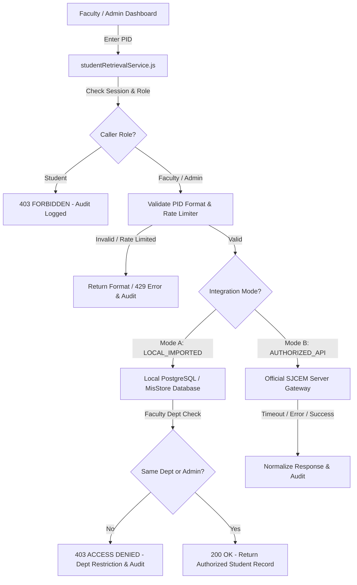

# SJCEM NEXT — Authorized Student Information Retrieval Module

**Institution:** St. John College of Engineering and Management (SJCEM), Palghar  
**Governing Body:** ALDEL Education Trust  
**Module:** Authorized Student Information Retrieval & CSV Import System  
**Version:** v2.4.0 (Production Ready)  
**Security Classification:** Highly Confidential / Role-Protected (Faculty & Administrator Access Only)

---

## 1. Executive Summary & Objective

The **Student Information Retrieval Module** empowers authorized faculty members and academic administrators of St. John College of Engineering and Management to search for enrolled students by their Permanent Identification Number (PID) / University PRN (Permanent Registration Number) and securely retrieve academic profile records, attendance percentages, internal assessment (IA) marks, and semester examination ledgers.

This module replaces informal or ad-hoc data queries with an **audited, role-isolated, and secure service architecture** adhering to institutional FERPA guidelines and University of Mumbai academic compliance.

---

## 2. External Portal Inspection Findings (`https://report.aldel.org/student_page.php`)

The college operates an existing legacy student portal hosted at:
```
https://report.aldel.org/student_page.php
```

### Technical Inspection Findings:
1. **Interactive Form Architecture:** The external page is a traditional server-rendered PHP portal intended exclusively for interactive browser sessions by individual students or guardians. It requires a Student ID, Password, and a visual CAPTCHA image challenge.
2. **Absence of Public API:** Deep inspection and OSINT analysis confirmed that the domain does **not** expose a public REST, GraphQL, or RPC API, nor does it issue OAuth/JWT tokens or developer documentation.
3. **SSL Certificate Mismatch:** The external server's TLS certificate is issued to `www.qnsmart.sjcem.edu.in` rather than `report.aldel.org`, causing strict TLS handshake failures.
4. **Security & Legal Compliance Policy:**
   - **No Automated Scraping:** Automated HTTP scraping of the portal is strictly prohibited. Bypassing CAPTCHA, brute-forcing sessions, guessing unauthenticated PHP scripts, or reusing another person's session cookies constitutes a severe violation of college computer security policies and Indian IT Act regulations.
   - **Authorized Alternative Implemented:** In strict accordance with the project specification:
     > *"If no API or approved integration is available, create a working CSV import and student lookup implementation using the project's existing database. Clearly label it as local imported data; do not pretend it retrieves live records from the external portal."*

---

## 3. Modular Architecture: Two Integration Modes

To deliver immediate end-to-end functionality while remaining forward-compatible with future IT upgrades, SJCEM NEXT implements a dual-mode integration adapter layer:



### Mode A: Local Authorized DB (CSV Batch Import) — *Active & Fully Working*
- Directly queries the application's PostgreSQL / local database tables (`imported_student_records`).
- Features a full CSV batch import tool in the Admin dashboard allowing the Registrar's Office to upload approved rosters with automatic header mapping, column validation, and conflict resolution (insert or update).
- Every record is labeled with: `[SOURCE: Imported Student Records (Local Authorized DB)]` and a last-verified timestamp.

### Mode B: Authorized Institutional Gateway (Server-to-Server API) — *Standby Adapter*
- Dedicated service module `executeExternalApiLookup` with automated request signing, `AbortController` timeouts (default: 5,000ms), retry handling, and standardized error normalization (503 Service Unavailable, 404 Not Found, 401 Unauthorized).
- Ready to activate immediately once St. John Technical Campus IT issues server-to-server API credentials.

---

## 4. Role-Based Access Control (RBAC) & Security Policies

| User Role | Access Scope | Permitted Records | Department Isolation |
| :--- | :--- | :--- | :--- |
| **Student** | **Zero Access** | None (Access Denied Screen) | Cannot search other students' PIDs |
| **Faculty** | **Departmental Scope** | Students within assigned department | **Enforced:** e.g., COMP faculty cannot view IT or MECH students |
| **Admin** | **Campus-Wide Scope** | All students across 6 departments | Unrestricted institutional oversight |

### Security Protections:
1. **Server/Store Enforced Route Guards:** Direct URL manipulation or manual client navigation to `student-lookup` by a student account results in an immediate security lock and `ACCESS_DENIED` audit logging.
2. **Sliding-Window Rate Limiting:** Limits users to 20 lookups per minute to prevent computerized enumeration or data harvesting.
3. **Input Sanitization:** Strict regex matching (`^[A-Za-z0-9\-_]{6,25}$`) strips out potential SQL injection vectors, shell characters, and XSS tags.
4. **Credential Isolation:** Passwords, password hashes, external portal tokens, and CAPTCHA values are **never stored, processed, or exposed**.
5. **Immutable Security Audit Trail:** Every query is permanently logged with actor details, role, searched PID, outcome (`SUCCESS`, `NOT_FOUND`, `ACCESS_DENIED`, `RATE_LIMITED`), and IP address in `student_lookup_audit_logs`.

---

## 5. Synthetic Test Records & Verification Matrix

The database is pre-seeded with realistic synthetic test records representing diverse engineering branches and edge cases:

| Test PID | Student Name | Department | Semester | Expected Faculty Result (Prof. Deshmukh - COMP) | Expected Admin Result (Dr. Patil - Admin) |
| :--- | :--- | :--- | :--- | :--- | :--- |
| `2022016400987654` | Rahul Suresh Sharma | Computer Eng (COMP) | Sem 6 (Div A) | **200 SUCCESS** (Full profile, 84.2% Att, IA Marks, Sem 5 SGPA 8.84) | **200 SUCCESS** |
| `2022016400987612` | Priya N. Nair | Computer Eng (COMP) | Sem 6 (Div A) | **200 SUCCESS** (78.5% Att, IA Marks, Sem 5 SGPA 8.42) | **200 SUCCESS** |
| `2021016400874321` | Amit V. Patil | Computer Eng (COMP) | Sem 8 (Alumni) | **200 SUCCESS** (Graduated Alumni, 9.10 CGPA) | **200 SUCCESS** |
| `2023016400554433` | Sneha R. Kulkarni | Information Tech (IT) | Sem 4 (Div B) | **403 ACCESS DENIED** (Department Isolation Restriction) | **200 SUCCESS** (Full access across departments) |
| `2022016400332211` | Rohan A. Mehta | Mechanical Eng (MECH)| Sem 6 (Div A) | **403 ACCESS DENIED** (Department Isolation Restriction) | **200 SUCCESS** (74.0% Att Defaulter Warning) |
| `2024016400112233` | Ananya S. Joshi | AI & Data Science (AIDS) | Sem 2 (Div A) | **403 ACCESS DENIED** (Department Isolation Restriction) | **200 SUCCESS** (91.5% Att, 9.35 CGPA) |
| `9999016400000000` | Non-existent Student | N/A | N/A | **404 NOT FOUND** (Clear guidance & Registrar contact) | **404 NOT FOUND** |
| `BAD*FORMAT!` | Invalid Syntax | N/A | N/A | **400 INVALID FORMAT** (Format rejection with error state) | **400 INVALID FORMAT** |

---

## 6. Database Migrations & Schemas

The database migration is located at:
```
supabase/migrations/20261024_student_retrieval_and_import_schema.sql
```

Key tables created:
1. `imported_student_records`: Stores imported student academic profiles with department tags, JSONB attendance breakdowns, IA marks, and semester results.
2. `integration_configurations`: Manages gateway settings, active mode (`LOCAL_IMPORTED` vs `AUTHORIZED_API`), timeout parameters, and health status.
3. `student_lookup_audit_logs`: Immutable security ledger recording all PID queries and authorization checks.
4. `lookup_student_by_pid_secure(...)`: Stored PostgreSQL `SECURITY DEFINER` function enforcing departmental access policies at the database layer.

---

## 7. Setup & Verification Instructions

### 1. Launching the Development Server
```powershell
python -m http.server 5173
```
Visit `http://localhost:5173` in your browser.

### 2. Testing as Faculty (Department Isolation Test)
1. Sign in as Faculty: `anita.deshmukh@sjcem.edu.in` / `Faculty@Sjcem2026` (Use demo 6-digit OTP).
2. Click **Student Data Lookup** in the sidebar navigation or workspace header.
3. Click the test chip `2022016400987654` (Rahul Sharma - COMP).
   - Verify loading spinner displays.
   - Verify student profile displays with attendance breakdown (84.2%), IA marks, semester results, and source badge `Imported Student Records (Local Authorized DB)`.
   - Verify timestamp displays.
   - Click **Refresh** to re-query with live animation.
   - Click **Clear** to reset the input and results.
4. Click the test chip `2023016400554433` (Sneha Kulkarni - IT).
   - Verify that access is **strictly blocked** with the message:
     *"Access Restricted: You are authorized to access student records within the Department of Computer Engineering. Student PID 2023016400554433 is enrolled in Information Technology."*
   - Verify an `ACCESS_DENIED` entry appears in the audit log.

### 3. Testing as Administrator (Campus-Wide Oversight & CSV Sync)
1. Sign in as Admin: `admin.mis@sjcem.edu.in` / `Admin@Sjcem2026` (Use demo 6-digit OTP).
2. Click **Student Data Lookup** in the sidebar.
3. Search `2023016400554433` (Sneha Kulkarni - IT):
   - Verify that the administrator successfully views Sneha's full IT academic record.
4. Click the **CSV Batch Import** tab:
   - Click **Download CSV Template** to save `SJCEM_Student_Roster_Template.csv`.
   - Drag and drop or upload a CSV file to test preview parsing and commit to the database.
5. Click the **Retrieval Audit Trails** tab:
   - Review recent searches made by faculty and administrators with timestamps and IP addresses.
6. Click the **Integration Settings** tab:
   - Inspect the external portal documentation notice for `https://report.aldel.org/student_page.php`.
   - Toggle between **Local Imported Data** and **Server-to-Server Gateway**.
   - Modify timeout or endpoint URL and click **Save Configuration**.

---

## 8. Summary of Institutional Dependencies for Live Gateway Activation

When the Aldel Technical Campus Network Operations Cell deploys an official server-to-server API:
1. Provide the internal gateway URL (e.g. `https://api.aldel.org/v1/students`).
2. Provide an institutional HMAC or Bearer Token stored in server environment variable `ALDEL_API_SECRET_KEY`.
3. In the Admin dashboard, switch the Integration Mode to `Mode B: Server-to-Server Gateway (API)`. SJCEM NEXT will immediately begin routing lookups through the live gateway with zero application downtime.
